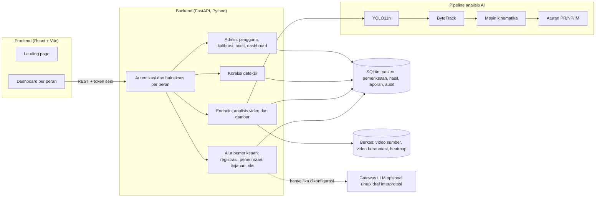
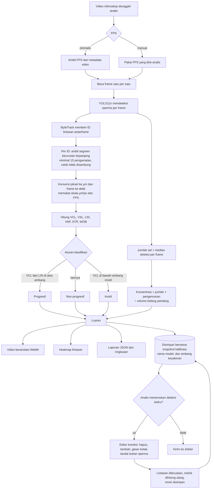
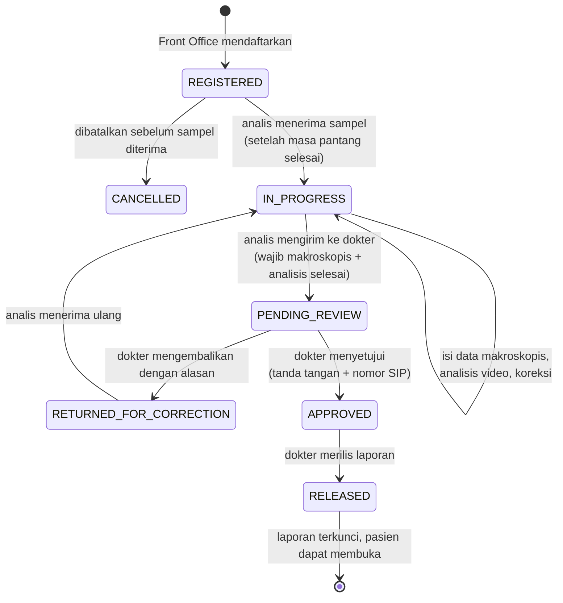
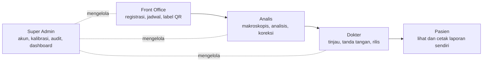

# Progres Pengembangan CASA-AI

Tim KAPAN YA DI POST KAMPUS, Politeknik Negeri Lhokseumawe. Status per 18 Oktober 2026.

Dokumen ini mencatat apa yang sudah dibangun, bagaimana sistem bekerja, dan apa yang berubah dari proposal awal. Hasil pengujian lengkap ada di [TESTING.md](TESTING.md), catatan kendali mutu perhitungan ada di [QC.md](QC.md).

## 1. Ringkasan status

| Komponen | Status |
| --- | --- |
| Model deteksi sperma YOLO11n | Selesai dilatih, dipakai di aplikasi |
| Pelacakan ByteTrack dan perhitungan kinematika | Berjalan pada video nyata |
| Klasifikasi PR/NP/IM dan estimasi konsentrasi | Berjalan, ambang dapat diatur |
| Aplikasi web lima peran (Front Office, Analis, Dokter, Pasien, Super Admin) | Berjalan |
| Alur registrasi sampai laporan dirilis | Berjalan, diuji otomatis |
| Koreksi deteksi oleh analis | Berjalan |
| Pengujian positif, negatif, edge case | 42 tes skenario, lihat [TESTING.md](TESTING.md) |

## 2. Arsitektur sistem

Teknologi utama: Python 3.10, FastAPI, Ultralytics (YOLO11n + ByteTrack), OpenCV, NumPy, SQLite, React 19, Vite.

## 3. Pipeline AI

Model AI hanya bertugas mendeteksi dan melacak sel. Semua angka setelah itu dihitung dengan rumus tetap dari koordinat lintasan dan nilai kalibrasi.

### Rumus yang dipakai

| Metrik | Perhitungan | Catatan |
| --- | --- | --- |
| VCL | panjang lintasan ÷ durasi | dipakai klasifikasi |
| VSL | jarak titik awal ke akhir ÷ durasi | |
| LIN | VSL ÷ VCL (0–1) | dipakai klasifikasi |
| VAP | panjang lintasan setelah 2 putaran penghalusan posisi ÷ durasi | eksperimental |
| STR | VSL ÷ VAP | eksperimental |
| WOB | VAP ÷ VCL | eksperimental |
| Konsentrasi | jumlah sel × pengenceran ÷ (lebar px × tinggi px × skala² × kedalaman bilik) | estimasi, juta/mL |

Ambang bawaan: PR jika VCL ≥ 25 µm/s dan LIN ≥ 0,8; IM jika VCL < 5 µm/s; selain itu NP. Super Admin dapat mengubahnya di Preset Kalibrasi, dan analis dapat mengubahnya untuk satu analisis tanpa mengubah preset. Rasio dengan pembagi nol disimpan sebagai `null`, bukan 0.

## 4. Alur kerja aplikasi

### Status pemeriksaan

Server menolak setiap perpindahan yang tidak ada di diagram ini. Setiap langkah dicatat di log audit beserta pelaku dan waktunya.

### Pembagian peran

## 5. Perubahan dari proposal awal

### Sesuai proposal

| Rencana di proposal | Implementasi |
| --- | --- |
| YOLO11n di-fine-tune dengan dataset mikroskopis sperma | Dilatih 50 epoch dari `yolo11n.pt`, imgsz 640 |
| ByteTrack untuk pelacakan antarframe | Dipakai lewat Ultralytics `bytetrack.yaml` |
| Mesin kinematika white-box VCL, VSL, VAP, LIN, STR | Ada, ditambah WOB |
| Klasifikasi PR/NP/IM berbasis aturan dengan ambang yang dapat diatur | Ada, ambang tersimpan di preset dan di setiap hasil |
| Kalibrasi µm/px, FPS, kedalaman bilik | Ada, ditambah faktor pengenceran dan preset bilik Makler, Leja, Neubauer |
| Luaran video beranotasi, heatmap, JSON, laporan | Ada; laporan dapat dicetak atau disimpan sebagai PDF |
| Human-in-the-loop, dokter sebagai pemutus | Ada; laporan tidak terbit tanpa persetujuan dan tanda tangan dokter |
| Akses berbasis peran untuk Admin, Analis, Dokter | Ada, diperiksa di server |

### Berubah atau dikembangkan lebih lanjut

| Proposal | Sekarang | Alasan |
| --- | --- | --- |
| Tiga peran | Lima peran: ditambah Front Office dan Pasien | Registrasi sampel dan penyerahan laporan ke pasien perlu pemilik tugas sendiri |
| Dokter "menetapkan diagnosis" dan dashboard menampilkan label seperti Normozoospermia | Sistem tidak memberi label diagnosis. Dokter melihat perbandingan dengan batas bawah acuan WHO edisi 6 lalu menulis interpretasinya sendiri | Mencegah hasil estimasi terbaca sebagai diagnosis otomatis |
| Klasifikasi hanya memakai ambang kecepatan | Memakai VCL dan LIN untuk PR, VCL untuk IM | Gerakan cepat tapi melingkar tidak boleh masuk progresif |
| VAP dari moving average | VAP dari dua putaran penghalusan posisi berbobot waktu dengan titik ujung tetap | Tetap benar untuk frame yang tidak berjarak sama |
| Jumlah sel dari lintasan | Jumlah sel dari median deteksi per frame sebelum filter tracking | Lintasan bisa terputus atau berganti ID sehingga tidak cocok untuk menghitung sel |
| Hasil analisis langsung masuk antrean dokter | Analis wajib mengisi data makroskopis dan dapat mengoreksi deteksi sebelum mengirim | Kesalahan deteksi bisa diperbaiki sebelum dokter meninjau |

### Fitur tambahan di luar proposal

- Registrasi pasien dengan nomor rekam medis otomatis dan akun portal pasien. Jenis kelamin diisi otomatis, dan pasien yang salah didaftarkan dapat dihapus selama sampelnya belum diterima laboratorium.
- Jadwal per slot 15 menit (maksimal 4 pasien per slot), pemeriksaan masa pantang 2–7 hari, dan peringatan jadwal ganda di hari yang sama.
- Label sampel dengan barcode dan QR, kartu jadwal pasien berisi masa pantang dan petunjuk, serta pemindai QR untuk Front Office.
- Editor koreksi deteksi per frame dengan pratinjau dan riwayat revisi. Kotak yang ditambahkan maupun dihapus dilacak ke frame sebelum dan sesudahnya, dan satu kali Undo membatalkan sekaligus.
- Tanda tangan dokter berupa gambar, wajib disertai nomor SIP, dan laporan terkunci setelah dirilis.
- Rekomendasi pada laporan berisi saran praktis untuk pasien yang disesuaikan dengan temuan (gaya hidup, pemeriksaan ulang, konsultasi), terpisah dari catatan teknis untuk peninjau.
- Draf interpretasi dari LLM untuk dokter. Fitur ini opsional, hanya aktif jika server dikonfigurasi, dan setiap pemakaiannya dicatat di log audit.
- Dashboard operasional Super Admin dengan ekspor PDF dan Excel tanpa nama pasien.
- Keamanan: kata sandi PBKDF2, token sesi disimpan sebagai hash, tautan berkas bertanda tangan yang berlaku 15 menit, dan log audit.
- Analisis gambar tunggal untuk hitung sel (tanpa motilitas).
- Model 3D interaktif di landing page yang menjelaskan perangkat, tahap analisis, review analis, dan laporan dokter, termasuk model anatomi sel sperma (berkas GLB) yang berputar dengan ekor bergelombang. Layarnya berisi simulasi dengan ambang yang sama dengan aplikasi, dan teksnya dijaga oleh tes agar tidak memuat klaim di luar fitur yang ada.

### Belum dikerjakan

| Rencana di proposal | Status |
| --- | --- |
| Prapemrosesan CLAHE | Belum diterapkan. Pipeline saat ini membaca frame tanpa CLAHE |
| Evaluasi tracking dengan IDF1, ID Switches, MOTA, MOTP | Belum dilakukan karena belum ada anotasi ground truth lintasan |
| Target waktu proses di bawah 60 detik per video | Belum diukur secara terstruktur |
| Telemetri GPU di dashboard admin (mockup Gambar 2.2) | Tidak dibuat. Dashboard admin berisi data operasional laboratorium |
| Checklist QC harian yang tersimpan | Checklist ada di tampilan, tetapi belum disimpan ke server |
| Integrasi SIMRS | Belum. Data tersedia lewat REST API sebagai dasar integrasi |
| Parameter ALH dan BCF | Belum dihitung |

## 6. Hasil pelatihan model

Model yang dipakai aplikasi: `train model/runs/train_sperma_undersampled_cepat2/weights/best.pt`.

| Metrik validasi (epoch 50) | Nilai |
| --- | --- |
| Precision | 0,985 |
| Recall | 0,974 |
| mAP50 | 0,990 |
| mAP50-95 | 0,878 |

Dataset berisi 15.440 gambar train, 1.929 valid, dan 1.932 test.

**Catatan penting:** pembagian train/valid/test dilakukan per frame secara acak (`resplit.py`), bukan per video. Frame yang berdekatan dari video yang sama bisa masuk ke train dan valid sekaligus, sehingga angka di atas kemungkinan lebih tinggi daripada kinerja pada video baru. Evaluasi ulang dengan pembagian per video adalah langkah berikutnya.

## 7. Pengujian

Pengujian otomatis mencakup tiga skenario sesuai ketentuan. Ringkasannya di bawah ini; rincian per kasus ada di [TESTING.md](TESTING.md).

| Skenario | Contoh yang diuji |
| --- | --- |
| Positif | Alur lengkap dari registrasi sampai pasien membuka laporan, pengembalian oleh dokter, dan kalibrasi terpakai di analisis |
| Negatif | Login salah, akses lintas peran, input tidak valid, urutan alur dilompati, pipeline gagal, dan bobot model hilang |
| Edge case | Nilai batas makroskopis dan masa pantang, slot penuh, dua analis pada satu sampel, laporan yang sudah dirilis, dan isolasi data antarpasien |

Hasil terakhir: 157 tes Python OK dan 46 tes frontend lulus. Dua kekurangan yang ditemukan dan belum diperbaiki:

1. Upload belum memvalidasi tipe dan ukuran berkas.
2. Jika pendaftaran sesi koreksi gagal setelah hasil analisis tersimpan, hasil tersebut masih bisa dikirim ke dokter.

Skenario edge case pada tingkat algoritma, yaitu video sangat padat, oklusi berat, dan banyak kotoran pada sampel, belum diuji dengan data beranotasi.

## 8. Langkah berikutnya

1. Memperbaiki dua temuan pengujian di atas.
2. Membagi ulang dataset per video lalu mengevaluasi ulang model pada video yang belum pernah dilihat.
3. Menerapkan CLAHE dan membandingkan hasil deteksi dengan dan tanpa CLAHE.
4. Membuat anotasi lintasan untuk mengukur IDF1, ID Switches, dan MOTA.
5. Mengukur waktu proses per video pada perangkat CPU dan GPU.
6. Meminta tinjauan tenaga ahli andrologi untuk ambang PR/NP/IM dan rumus konsentrasi.
