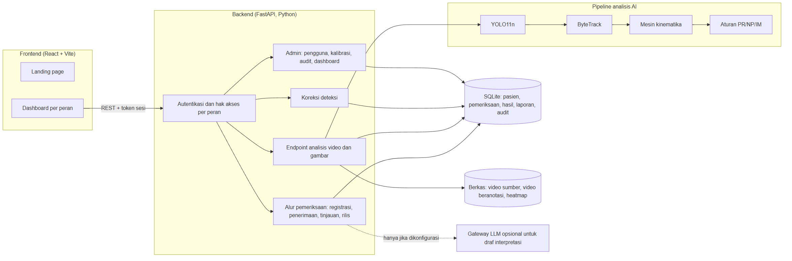
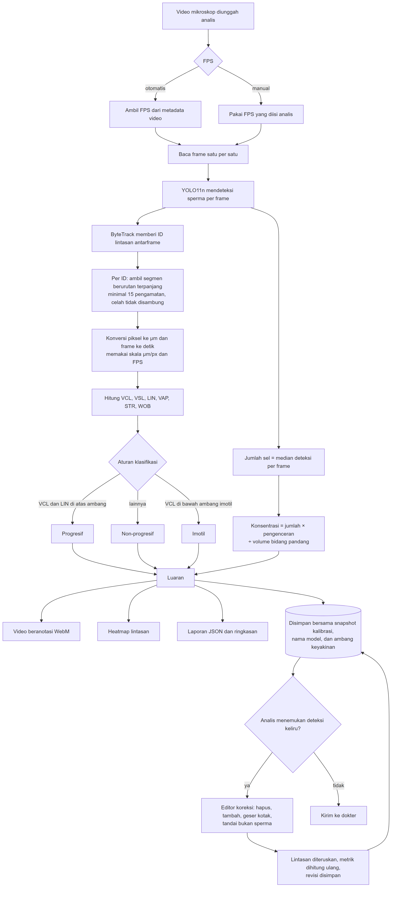
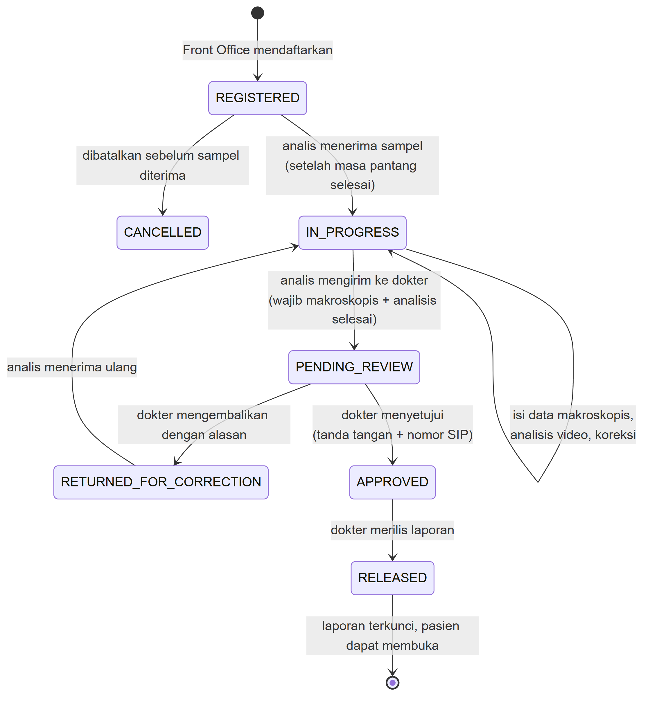
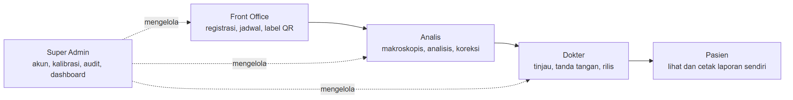

# CASA-AI: Computer-Assisted Sperm Analysis

CASA-AI menganalisis video mikroskop untuk mendeteksi dan melacak sperma, menghitung kecepatan serta kelurusan geraknya, lalu mengelompokkannya menjadi progresif (PR), non-progresif (NP), dan imotil (IM). Hasil diperiksa analis laboratorium dan disetujui dokter sebelum laporan dirilis ke pasien. Sistem ini adalah alat bantu laboratorium, bukan alat diagnosis.

Aplikasi terdiri atas backend FastAPI (Python), pipeline AI berbasis YOLO11n dan ByteTrack, serta frontend React + Vite.

Dokumen terkait:

- [PROGRESS.md](PROGRESS.md): progres pengembangan dan perubahan dari proposal awal
- [TESTING.md](TESTING.md): hasil pengujian skenario positif, negatif, dan edge case
- [QC.md](QC.md): catatan kendali mutu perhitungan

## Struktur Repositori

- `backend/` : API FastAPI, alur pemeriksaan, autentikasi, dan endpoint analisis.
- `frontend/` : Antarmuka pengguna berbasis React + Vite.
- `train model/` : Skrip pelatihan, pipeline analisis, tracking, dan perhitungan kinematika.
- `tests/` : Pengujian otomatis backend dan pipeline.
- `docs/diagrams/` : Diagram sistem dalam format PNG dan SVG.

## Dokumentasi Sistem

### 1. Arsitektur sistem



Frontend mengirim permintaan ke backend FastAPI dengan token sesi. Backend memeriksa peran pengguna untuk setiap permintaan, lalu meneruskannya ke modul yang sesuai: alur pemeriksaan, analisis video, koreksi deteksi, atau administrasi. Analisis video menjalankan pipeline AI. Data pasien, pemeriksaan, hasil, laporan, dan log audit disimpan di SQLite, sedangkan video sumber, video beranotasi, dan heatmap disimpan sebagai berkas. Draf interpretasi dari LLM bersifat opsional dan hanya aktif jika server dikonfigurasi.

### 2. Pipeline AI



1. **FPS.** Diambil dari metadata video, atau diisi manual oleh analis jika metadata tidak sesuai (misalnya pada video slow motion).
2. **Deteksi.** YOLO11n yang di-fine-tune pada dataset mikroskopis mendeteksi sperma di setiap frame.
3. **Jumlah sel.** Dihitung dari median jumlah deteksi per frame. Angka ini dipakai untuk estimasi konsentrasi.
4. **Pelacakan.** ByteTrack memberi ID yang sama untuk sperma yang sama di frame berikutnya. Untuk setiap ID diambil satu segmen berurutan terpanjang dengan minimal 15 pengamatan.
5. **Konversi.** Koordinat piksel diubah ke mikrometer dengan skala µm/px, dan nomor frame diubah ke detik dengan FPS.
6. **Kinematika.** Dihitung VCL, VSL, LIN, VAP, STR, dan WOB dengan rumus tetap, bukan oleh model AI.
7. **Klasifikasi.** PR jika VCL ≥ 25 µm/s dan LIN ≥ 0,8; IM jika VCL < 5 µm/s; selain itu NP. Ambang ini dapat diatur.
8. **Luaran.** Video beranotasi, heatmap lintasan, dan laporan JSON. Semuanya disimpan bersama snapshot kalibrasi, nama model, dan ambang keyakinan.
9. **Koreksi.** Jika ada deteksi keliru, analis memperbaikinya di editor per frame lalu metrik dihitung ulang sebelum hasil dikirim ke dokter.

### 3. Status pemeriksaan



Setiap pemeriksaan bergerak dari `REGISTERED` sampai `RELEASED`. Server menolak perpindahan status yang melompati urutan. Dokter dapat mengembalikan hasil ke analis dengan alasan tertulis. Setelah dirilis, laporan tidak dapat diubah. Setiap perpindahan dicatat di log audit beserta pelaku dan waktunya.

### 4. Pembagian peran



| Peran | Tugas |
| --- | --- |
| Front Office | Registrasi pasien dan pemeriksaan, jadwal, cetak label QR dan kartu jadwal |
| Analis | Menerima sampel, mengisi data makroskopis, menjalankan analisis, mengoreksi deteksi, mengirim ke dokter |
| Dokter | Meninjau hasil, menulis interpretasi, menyetujui dengan tanda tangan dan nomor SIP, merilis laporan |
| Pasien | Melihat jadwal dan membuka laporannya sendiri yang sudah dirilis |
| Super Admin | Mengelola akun, preset kalibrasi, log audit, dan dashboard operasional |

Diagram dibuat dari kode Mermaid di [PROGRESS.md](PROGRESS.md). Versi SVG tersedia di folder yang sama untuk dicetak dalam ukuran besar.

## Prasyarat

Pastikan Anda telah menginstal:
- [Node.js](https://nodejs.org/) (versi 16 atau terbaru)
- [Python](https://www.python.org/) (versi 3.8 atau terbaru)
- Git

---

## Cara Menjalankan Proyek

Proyek ini memiliki dua komponen utama yang perlu dijalankan secara terpisah: Backend dan Frontend.

### 1. Menjalankan Backend (FastAPI & Model)

Buka terminal dan navigasi ke direktori root repositori ini.

1. Pindah ke direktori `backend`:
   ```bash
   cd backend
   ```

2. (Opsional namun disarankan) Buat dan aktifkan virtual environment:
   ```bash
   python -m venv venv
   # Di Windows:
   venv\Scripts\activate
   # Di Mac/Linux:
   source venv/bin/activate
   ```

3. Instal dependensi backend:
   ```bash
   pip install -r requirements.txt
   ```

4. Instal dependensi model AI (diperlukan oleh backend untuk inferensi):
   ```bash
   pip install -r "../train model/requirements.txt"
   ```

5. Jalankan server backend FastAPI:
   ```bash
   uvicorn main:app --reload
   ```
   *Backend sekarang berjalan di `http://localhost:8000` (Anda dapat melihat dokumentasi API di `http://localhost:8000/docs`).*

### 2. Menjalankan Frontend (React + Vite)

Buka terminal baru dan navigasi ke direktori root repositori.

1. Pindah ke direktori `frontend`:
   ```bash
   cd frontend
   ```

2. Instal dependensi:
   ```bash
   npm install
   ```

3. Jalankan server pengembangan frontend:
   ```bash
   npm run dev
   ```
   *Aplikasi frontend sekarang berjalan dan dapat diakses melalui browser:*
   - **Halaman Beranda (Home):** `http://localhost:5173/`
   - **Dashboard Medis & Admin:** `http://localhost:5173/dashboard`

---

## Tentang Model (Train Model)

Jika Anda ingin melakukan pelatihan ulang atau eksperimen dengan model, buka direktori `train model`. Anda dapat menyesuaikan konfigurasi di dalam file python terkait pelatihan maupun pada `requirements.txt` spesifik AI.

## Catatan Tambahan
Pastikan backend berjalan terlebih dahulu sebelum Anda melakukan request analisis dari frontend agar komunikasi API berjalan lancar.

## Kalibrasi Analisis

Kalibrasi diterapkan setelah deteksi YOLO11n dan pelacakan ByteTrack, bukan untuk mengubah bobot atau melatih ulang model deteksi. Parameter menentukan konversi piksel ke mikrometer, waktu gerak, konsentrasi berdasarkan volume bidang pandang, dan klasifikasi motilitas berbasis aturan.

1. Jalankan backend dan frontend, lalu buka pengaturan kalibrasi di portal publik atau dashboard.
2. Ukur **skala piksel dalam µm/px** menggunakan mikrometer pada konfigurasi optik dan resolusi yang digunakan. Nilai awal `0.8` hanyalah contoh, bukan hasil verifikasi perangkat. Gambar yang di-resize memerlukan penyesuaian skala.
3. Pilih bilik sesuai spesifikasi aktual: Makler 10 µm, Leja 20 µm, Improved Neubauer 100 µm, atau **Custom**. Nilai awal 20 µm berlabel Custom, bukan Makler. Mengubah kedalaman preset secara manual mengalihkan tipe menjadi Custom.
4. Mode FPS **otomatis** memakai metadata video. Gunakan **manual** untuk FPS rekaman aktual bila metadata tidak tepat, misalnya video slow-motion. FPS yang sama digunakan untuk menghitung gerak dan menulis video hasil. Metadata FPS yang tidak tersedia menghasilkan pesan untuk menggunakan mode manual, bukan tebakan diam-diam.
5. Masukkan faktor pengenceran (`1` untuk tanpa pengenceran), ambang kecepatan VCL, ambang kelurusan LIN, dan ambang immotil.
6. Klik **Simpan Konfigurasi ke Server**. Konfigurasi disimpan secara atomik ke `backend/data/calibration.json`, tetap ada setelah reload/restart, dan dimuat oleh kedua halaman. Ini menyimpan parameter aplikasi, **bukan mengirim konfigurasi ke hardware mikroskop**. Perubahan formulir yang belum disimpan hanya berlaku untuk analisis yang dijalankan dari formulir tersebut.

### Perhitungan dan Validasi

- Jarak fisik = jarak piksel × skala (µm/px).
- VCL = panjang lintasan fisik / durasi lintasan; VSL = perpindahan awal–akhir / durasi; LIN = perpindahan / panjang lintasan.
- Kategori progresif memerlukan VCL dan LIN yang memenuhi kedua ambang; kategori immotil memakai ambang VCL tersendiri. VAP, STR, dan WOB tersedia sebagai estimasi eksperimental; ALH dan BCF belum dihitung.
- VAP memakai panjang lintasan setelah dua putaran penghalusan posisi interior dengan tetangga berbobot waktu, dibagi durasi. Posisi awal/akhir tetap. STR = VSL/VAP; WOB = VAP/VCL. Rasio dirata-rata per lintasan dan pembagi nol menghasilkan `null`, bukan nol. Snapshot `analysis_method` mencatat metode dan jumlah putaran; hasil tidak otomatis sebanding dengan CASA vendor lain.
- Volume bidang pandang = lebar piksel × tinggi piksel × skala² × kedalaman bilik. Konsentrasi memakai median deteksi sperma **sebelum** filter tracking pada video, atau jumlah deteksi pada citra, dikalikan faktor pengenceran. Median pecahan (misalnya 28,5) dipertahankan, bukan dibulatkan turun.
- Motilitas memakai satu segmen kontinu terpanjang per ID dengan minimal 15 pengamatan. Celah frame tidak disambung. `summary.motility_denominator` mencatat jumlah ID yang menjadi pembagi PR/NP/IM; `classification_counts` mencatat jumlah tiap kategori. Ini berbeda dari median deteksi per frame dan belum menjamin jumlah sel biologis unik.
- `quality` merekam ID yang diterima/ditolak, ID dengan celah, jumlah frame, dan proporsi deteksi yang mendapat ID. Angka ini membantu memeriksa tracking, bukan ukuran akurasi. Hasil lama harus dianalisis ulang untuk memperoleh metrik baru.
- Hanya deteksi sperma yang dihitung dan dilacak. Bobot model yang tidak memiliki label sperma ditolak.
- Skala, FPS manual, kedalaman, dan ambang progresif harus positif dan terbatas; pengenceran minimal 1; LIN berada pada 0–1; ambang immotil tidak boleh melebihi ambang progresif. Validasi berlaku di frontend dan backend. LIN `0` dan ambang immotil `0` diperbolehkan.
- Respons analisis dan laporan JSON merekam snapshot `calibration` yang benar-benar digunakan, termasuk FPS efektif, sumber FPS, resolusi, skala, bilik, dan ambang. Laporan Markdown video juga memuat snapshot ini. Perubahan konfigurasi berikutnya tidak mengubah hasil lama.
- Citra tunggal dan video tanpa lintasan yang cukup tidak menyediakan penilaian motilitas (`motility_available: false`); antarmuka menampilkan N/A, bukan menyatakan semua sel immotil.

### API dan CLI

- `GET /api/calibration`: membaca profil tersimpan atau nilai awal jika belum ada profil.
- `PUT /api/calibration`: memvalidasi dan menyimpan profil lengkap. Frontend mengirim seluruh field profil.
- `POST /api/analyze` dan `POST /api/analyze_image`: memakai profil tersimpan untuk field yang tidak dikirim; field multipart yang dikirim menjadi override untuk analisis tersebut. Request lama yang hanya mengirim `fps` tanpa `fps_mode` diperlakukan sebagai FPS manual.
- Analisis menolak berjalan jika bobot model sperma terlatih tidak tersedia; tidak menggunakan fallback model objek generik.

Contoh pipeline mandiri, dari direktori `train model` (pipeline mandiri memakai argumen/default CLI, bukan otomatis membaca profil server):

```powershell
python pipeline.py --video "../SAMPEL TEST/TEST 1.mp4" --model "runs/train_sperma_undersampled_cepat2/weights/best.pt" --pixel-scale 0.8 --chamber-depth 20 --fps-mode auto
```

**Batas penggunaan:** konfigurasi ini mendukung pengujian teknis lokal. Nilai awal ambang bukan sertifikasi atau jaminan kepatuhan klinis WHO. Akurasi optik, model, dan hasil perlu divalidasi pada perangkat serta data laboratorium sebelum penggunaan klinis. Endpoint API memerlukan login dan memeriksa peran pengguna di server. Tetap gunakan HTTPS dan simpan kredensial di variabel lingkungan jika API dibuka ke internet.
